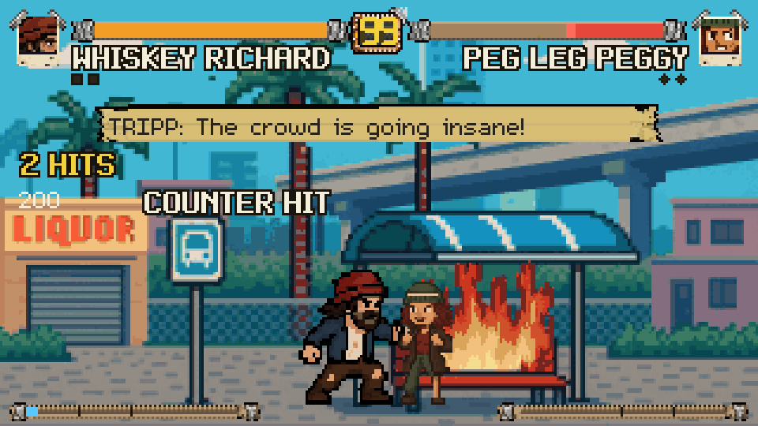
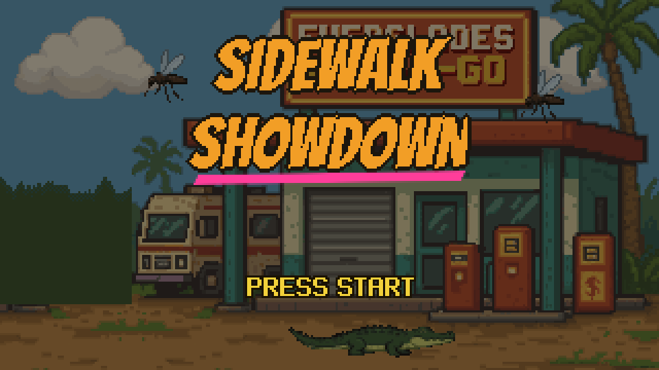
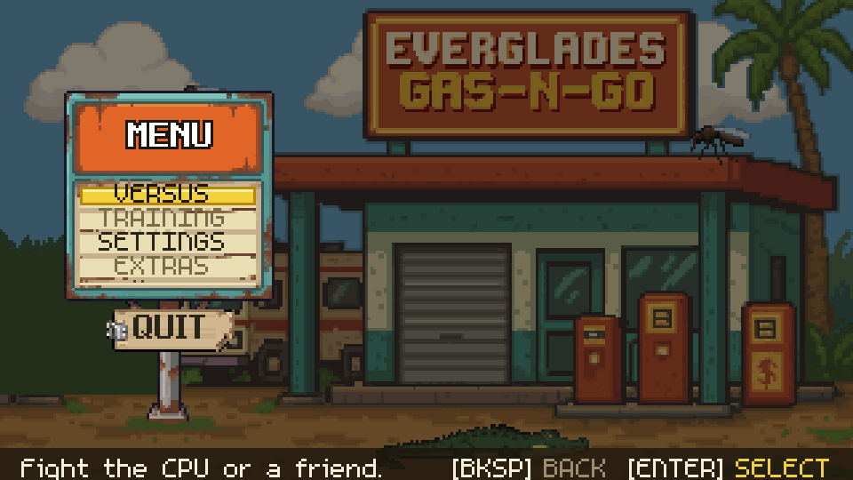
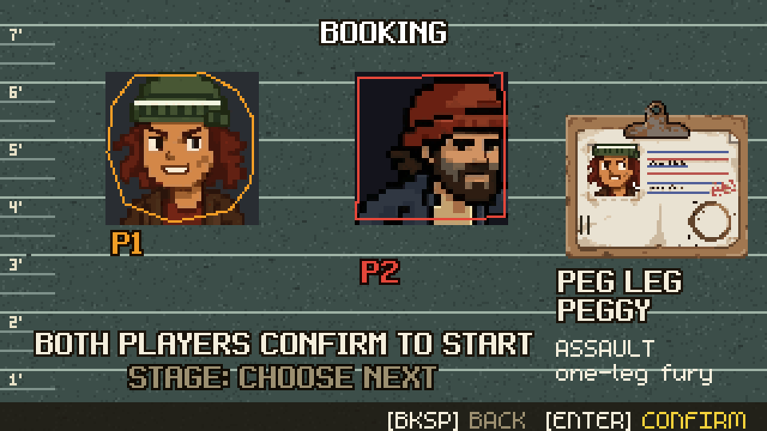
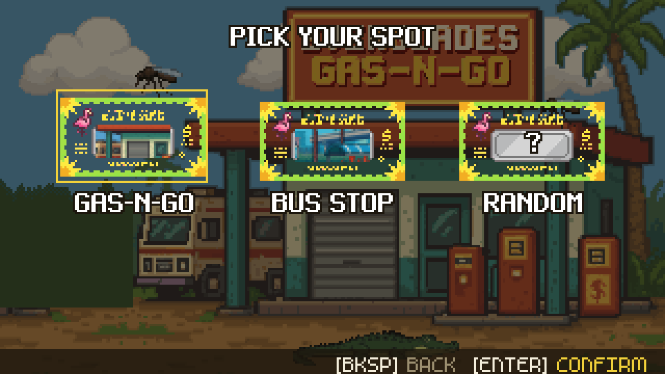
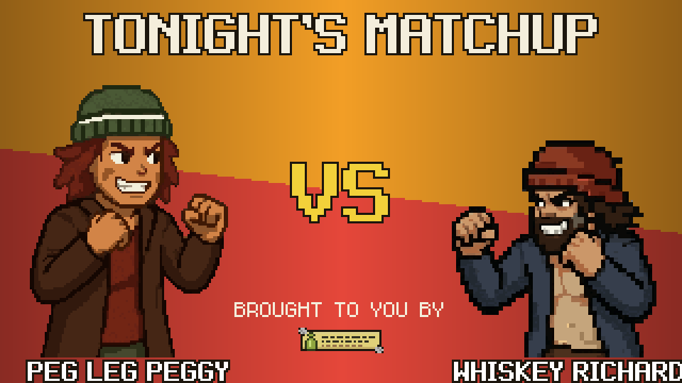
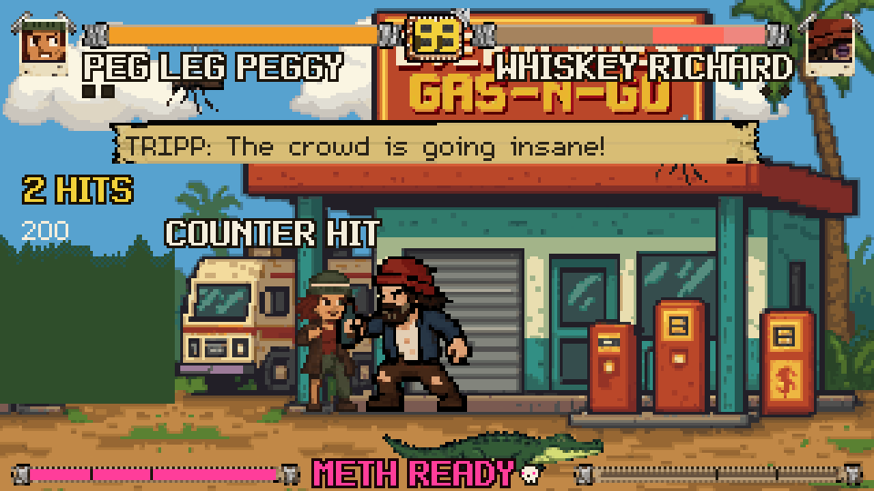
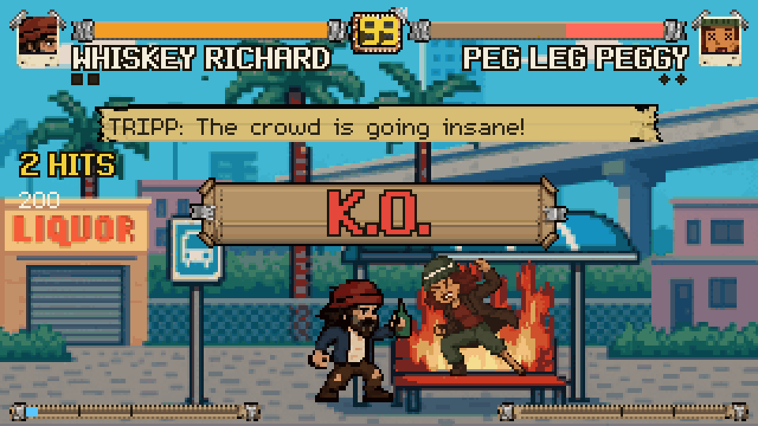
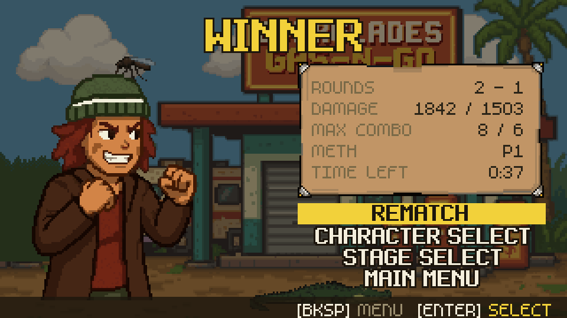

# Sidewalk Showdown

**A raunchy, Mature-rated, retro pixel-art arcade fighter.** A washed-up livestreamer named Tripp Vlogs turns Florida sidewalk chaos into a rigged, winner-takes-all tournament, and you fight your way through it with a cast of gas-station legends.

[](https://github.com/violentwave/sidewalk-showdown/actions/workflows/tests.yml)
[](https://github.com/violentwave/sidewalk-showdown/actions/workflows/export.yml)

<p align="center">
  
</p>

| | |
|---|---|
| **Engine** | Godot 4.7, GDScript, fixed 60 Hz deterministic simulation |
| **Resolution** | 320×180 native, integer-scaled, nearest-neighbor |
| **Platforms** | Windows and Linux builds from CI; macOS planned |
| **Status** | Playable vertical slice: 2 fighters, 2 stages, full front end ([status](docs/PHASE_STATUS.md)) |
| **Rating** | Mature: crude humor, drug references, cartoon violence |
| **License** | All rights reserved until a LICENSE file lands ([options](docs/LICENSE_OPTIONS.md)) |

## What's in the game

**Two fighters.** Peg Leg Peggy and Whiskey Richard, each with authored sprite animation for every state and all 16 attack rows, directional specials, EX versions, throws and a METHtality finisher.

**Two stages with ambience.** The Everglades Gas-N-Go (drifting clouds, mosquitoes, a sunbathing gator) and the Bus Stop (a burning shelter, a flickering liquor sign).

**A real combo system.** Chains and special cancels on hit, quick-dial macros, the Clip Cancel (special + grab in recovery, 25 meter), launcher juggles on a point budget, themed stuns you mash out of, and a combo breaker: grab + special in hitstun, free once per round, 40 meter after that. Damage scaling, repeat penalties and variety bonuses are all data-tuned ([design](docs/COMBO_SYSTEM_DESIGN.md)).

**Fighting-game fundamentals.** Frame data, blocking (chip can't KO), hitstop, input buffers, throw techs, side switching and pass-through, rounds, timer and sudden death. Meter builds only from hits you land.

**Solo and local versus.** Fight the CPU on EASY, NORMAL or HARD. It plays by the same input rules as a human and uses the whole combo system ([CPU](docs/CPU_OPPONENT.md)). Or grab a controller for 2-player versus.

**A street-junk front end.** A content warning, The Clip (a 15-panel comic intro), a title screen, a gas-station price-board menu, a mugshot booking wall, scratch-off stage tickets, a VS bumper and a Results screen. The game uses its own pixel font, Sidewalk Marker.

**A HUD made of junk.** Taped photo portraits that bruise and get KO'd, duct-tape health bars with a red ghost that catches up after each combo, a gas-pump timer, hype meters that flip pink with a wobbling skull at METH READY, cardboard round banners, and Tripp's commentary on masking tape.

**Settings and accessibility.** Video, audio buses, gameplay, accessibility (reduce flashing, high-contrast HUD) and streamer options, saved to `user://settings.cfg`.

## Screenshots

| | |
|---|---|
|  |  |
| **Title** | **Main menu:** the Gas-N-Go price board |
|  |  |
| **Booking:** character select | **Pick your spot:** stage select |
|  |  |
| **VS bumper** | **METH READY** at the Gas-N-Go |
|  |  |
| **K.O.** | **Results** |

## Play it

**Download a build:** every push to `main` exports a Linux x86_64 binary and a Windows x64 `.exe`, each a single runnable file. Open the latest successful [export run](https://github.com/violentwave/sidewalk-showdown/actions/workflows/export.yml) and download `sidewalk-showdown-linux-<sha>` or `sidewalk-showdown-windows-<sha>` from its Artifacts (kept 14 days).

**Run from source:** install Godot 4.7.x, then:

```bash
godot --headless --path game --import   # first run: build the import cache
godot --path game                       # play
```

## Controls

P1 plays on keyboard + mouse; P2 plays on any controller (d-pad or left stick).

| Action | P1 keyboard / mouse | P2 controller |
|---|---|---|
| Move | A / D | D-pad or left stick |
| Jump | W | Up |
| Crouch | S | Down |
| Light attack | J or left click | X |
| Heavy attack | K or right click | Y |
| Special | L or middle click | B |
| Grab / throw | U | A |
| METHtality | I | Right shoulder (RB / R1) |
| Pause | Esc | Start / Menu |

- **Block** by holding away from your opponent; hold down-away to block lows.
- **EX specials:** hold Heavy while pressing Special to spend 50 meter.
- **Clip Cancel:** Special + Grab during your move's recovery (25 meter, once per combo).
- **Combo breaker:** Grab + Special while you're being comboed.
- **METHtality:** press METHtality with a full meter.
- **Stunned?** Mash Up to shake out.
- **Menus:** confirm with Enter, J or pad A; go back with Backspace or pad B.
- **Debug keys:** F1 hit/push boxes (on by default), F2 frame state, F3 input history, F4 slow motion, F5 frame step, F6 refill.

## Roadmap

- **Now:** the combo HUD (scaling tint, juggle and stun readouts, breaker pips).
- **Next:** control remapping, Extras and Credits, a training mode, and per-round win letters on the round pips.
- **Later:** the rest of the 15-fighter roster, more stages, the arcade ladder up to Tripp Vlogs, METHtality cinematics, final audio and voice, and rollback netcode (the simulation is already deterministic and fully serializable).

The full plan is in the [GDD](GDD.md); story and world canon are in the [Game Bible](GAME_BIBLE.md) and [Characters](CHARACTERS.md).

## For developers

**Tests.** Every suite is headless and deterministic, and CI runs them all on each push and PR:

```bash
for t in game/tests/*_test.gd; do
  godot --headless --path game --script "res://tests/$(basename "$t")"
done
```

Per-suite check counts live in [`docs/PM_BRIEF.md`](docs/PM_BRIEF.md). `tests/air_probe.gd` and `tests/juggle_probe.gd` print balance metrics and assert nothing.

**Architecture rules**

- **The simulation runs on a fixed 60 Hz clock.** Frame data, hitstun, hitstop and buffers are counted in sim frames, and HUD counters run on the same tick, so pause and hitstop freeze everything. No global RNG, delta or wall-clock time touches the sim.
- **State is serializable.** `MatchRoot.serialize()` / `load()` capture the whole match, for replays and rollback.
- **Fighters are data.** Stats and moves live in `game/resources/fighters/*.tres`; combat code has no per-fighter balance.
- **Art is layered.** Source art in `art/source/` is never edited; prep scripts in `art/tools/` generate the runtime art in `game/` (including the UI set via `art/tools/prepare_ui.gd`).
- **Presentation never changes gameplay.** UI, animation and HUD only read the sim.

**Repository map**

```text
game/          Godot project: scenes, scripts, resources, tests, tools, runtime art
art/source/    owner-supplied source art (read-only)
art/tools/     reproducible art and font prep tools
docs/          design, status, pipelines, UI rules, screenshots
```

**Docs**

| Doc | What it covers |
|---|---|
| [`docs/PM_BRIEF.md`](docs/PM_BRIEF.md) | Current features, architecture, test inventory, commands |
| [`docs/PHASE_STATUS.md`](docs/PHASE_STATUS.md) | GDD phase requirements vs evidence |
| [`docs/KNOWN_ISSUES.md`](docs/KNOWN_ISSUES.md) | Known gaps, decisions and the test inventory |
| [`docs/COMBO_SYSTEM_DESIGN.md`](docs/COMBO_SYSTEM_DESIGN.md) | Combo system design and the owner-approved decisions |
| [`docs/UI_SCREENS.md`](docs/UI_SCREENS.md) | Screens, HUD layout, typography and contrast rules |
| [`docs/UI_ASSETS.md`](docs/UI_ASSETS.md) | UI art pipeline and the approved asset manifest |
| [`docs/STAGES.md`](docs/STAGES.md) | Stage layers, ambience, adding a stage |
| [`docs/CPU_OPPONENT.md`](docs/CPU_OPPONENT.md) | How the CPU plays |
| [`docs/ART_CREDITS.md`](docs/ART_CREDITS.md) | Art provenance and font licenses |

**Contributing.** `main` only accepts squash-merged PRs ([why](docs/MAIN_BRANCH_GUARD.md)). Branch from `origin/main`, run the suites, open a PR, wait for green CI, then squash-merge. Keep gameplay-data changes separate from presentation changes.

**Canon locks:** Tripp Vlogs is the only boss and isn't playable. The roster is 15 fighters, each with one unique METHtality. No real towns, brands or public figures: this is a fictional "Sidewalk Florida".
