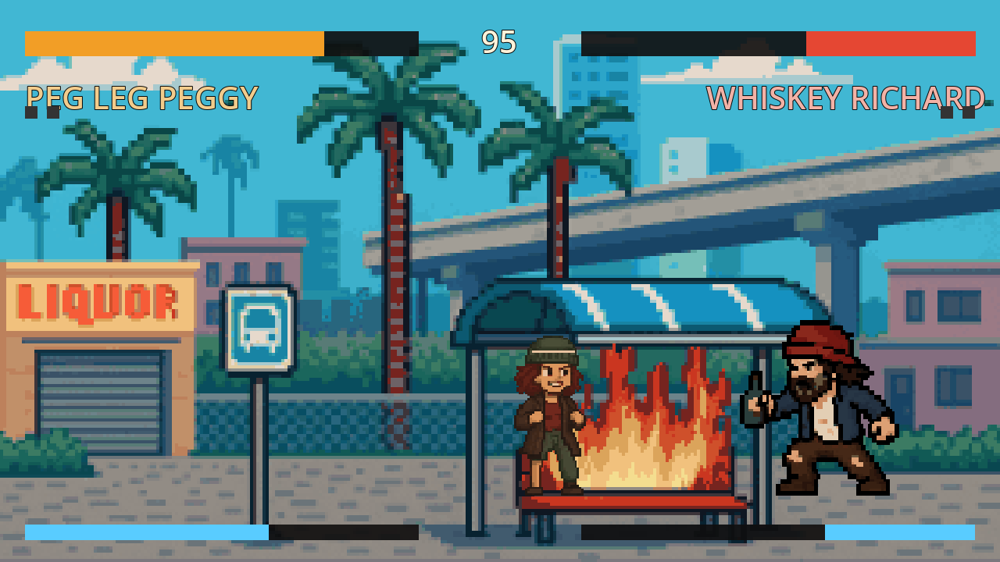
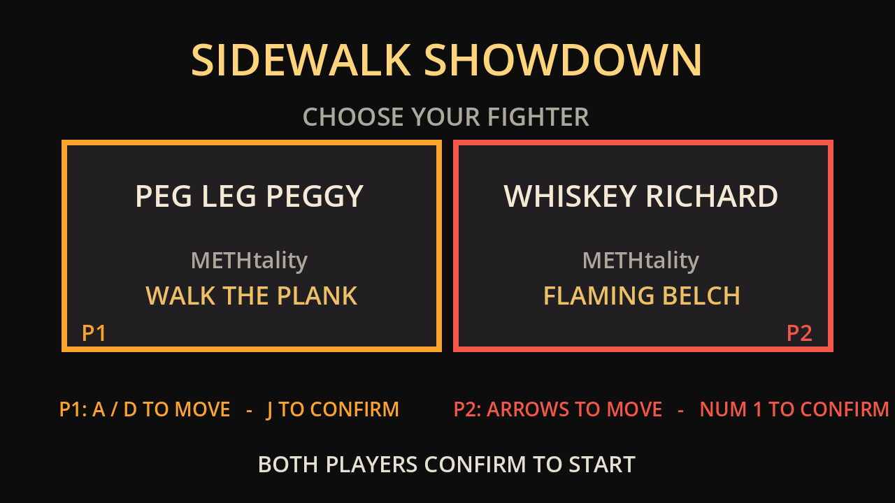

# Sidewalk Showdown

**A mature-rated 2D retro pixel-art arcade fighter about a washed-up livestreamer
who turns sidewalk chaos into a rigged tournament.**

[](https://github.com/violentwave/sidewalk-showdown/actions/workflows/tests.yml)
[](https://github.com/violentwave/sidewalk-showdown/actions/workflows/export.yml)

<p align="center">
  
</p>

| The Clip — intro | Choose your fighter |
|---|---|
|  |  |

| | |
|---|---|
| **Engine** | Godot 4.7 (`game/`) |
| **Target** | PC first — Windows / Linux / macOS |
| **Status** | GDD Phase 2 — vertical slice, in progress ([`docs/PHASE_STATUS.md`](docs/PHASE_STATUS.md)) |
| **License** | TBD — treat as all-rights-reserved until a LICENSE file lands ([`docs/LICENSE_OPTIONS.md`](docs/LICENSE_OPTIONS.md)) |

## What's playable today

- **The Clip** — a 15-panel comic intro that leads into character select, with
  Space-only advancement and a complete skip path.
- **Two-player local versus** — Peg Leg Peggy vs Whiskey Richard on the Bus
  Stop at night, one keyboard.
- **Authored sprite animation** — both fighters play per-state and per-move
  clips from the owner's PixelLab batch: jumps, walks, guard, hit reactions,
  knockdown/wake-up, and all 16 attack rows per fighter
  ([`docs/PIXELORAMA_PIPELINE.md`](docs/PIXELORAMA_PIPELINE.md) §8–§9a).
- **Fighting-game systems** — 60 Hz deterministic simulation, frame data,
  blocking with chip that can't KO, hitstop, buffers, directional specials,
  EX spenders, throws and throw techs, juggle cap, and a METHtality finisher.
- **Match structure** — rounds, timer, sudden death after repeated timeouts,
  KO flow, pause menu, and a text-only Tripp commentary sample.

Not in yet: gamepad and remapping, stage select, CPU AI, campaign, final
audio/voice/VFX, and final art/cleaning for some clips. Online play is deferred
beyond v0.1 per GDD §2.4/§16.

## Quick start

Requires **Godot 4.7.x** (the project reports `4.7.2`).

```bash
godot --path game                # play
godot --headless --path game --import   # first run: build the import cache

# test suites (all headless, all deterministic)
godot --headless --path game --script res://tests/combat_test.gd
godot --headless --path game --script res://tests/round_flow_test.gd
godot --headless --path game --script res://tests/character_select_test.gd
godot --headless --path game --script res://tests/the_clip_test.gd
```

Current suites: **combat 337 checks**, round flow 34, character select 18,
The Clip 23 — all green in CI (`tests.yml`). `tests/air_probe.gd` prints balance
metrics and asserts nothing.

## Controls

Both players share one keyboard: **P1 is WASD only**, the arrow keys belong to P2.

| Action | P1 (Peg Leg Peggy) | P2 (Whiskey Richard) |
|---|---|---|
| Move | A / D | ← / → (or Numpad 4 / 6) |
| Jump | W | ↑ (or Numpad 8) |
| Crouch | S | ↓ (or Numpad 2) |
| Light attack | J | Numpad 1 or `,` |
| Heavy attack | K | Numpad 3 or `.` |
| Special | L | Numpad 5 or `/` |
| Grab / throw | U | Numpad 7 or `;` |
| METHtality | I | Numpad 9 or `'` |
| Pause | Esc | Numpad 0 |

- **Block** by holding away from the opponent (down-away blocks lows), including
  during blockstun. Chip damage cannot KO — a blocked hit always leaves 1 HP.
- **EX specials:** hold Heavy while pressing Special to spend 50 meter on the
  stronger version; without meter the base special comes out for free.
- **METHtality:** with a full meter, press METHtality to spend the whole bar.
  Current presentation is a freeze plus banner; the normal KO flow ends the round.
- **Specials are directional:** neutral, forward, back, down, and air (GDD §4.4).
- `Enter` restarts after a match ends. Pause menu drives with W/S, arrows, or
  Numpad 8/2; J, Numpad 1, or Enter picks.

Debug keys: **F1** boxes (on by default), **F2** frame state/advantage/invuln,
**F3** input history, **F4** slow motion, **F5** frame-step, **F6** refill both
fighters. Regenerate the input map with
`godot --headless --path game --script res://tools/setup_input.gd` after editing
the table above.

## Builds

Pushing to `main` (or a `v*` tag) exports both desktop targets: a Linux x86_64
binary and a Windows x64 `.exe`, each with the PCK embedded as a single runnable
file. Grab them from the **Artifacts** section of an `export` run in the Actions
tab, named `sidewalk-showdown-linux-<sha>` / `sidewalk-showdown-windows-<sha>`
(kept 14 days).

Presets live in `game/export_presets.cfg` (`linux`, `windows`). Locally, with
Godot 4.7.2 export templates installed:

```bash
godot --headless --path game --import
godot --headless --path game --export-release linux build/linux/sidewalk_showdown.x86_64
godot --headless --path game --export-release windows build/windows/sidewalk_showdown.exe
```

> The export workflow deliberately does **not** cache Godot's ~1 GB export
> templates: the free Actions storage budget is 500 MB, so a template cache
> starves artifact uploads; downloading them per run keeps exports publishable.
>
> **Current status:** artifact uploads are rejected by an account-level Actions
> storage check even with zero stored artifacts, so both export runs build but
> publish nothing. That is a billing/account issue, not a code failure — see
> [`docs/KNOWN_ISSUES.md`](docs/KNOWN_ISSUES.md). Local exports work with the
> commands above.

## Repository map

```text
game/                  Godot 4.x project
  scenes/              match, fighters, stages, menus, HUD
  scripts/             combat, match, ui, debug, stages, audio
  resources/           data resources: fighter stats/moves, stages, match roster
  tests/               headless suites + manual render/soak harnesses
  tools/               data generators, input setup, screenshot/README capture
  art/                 runtime art (idle sheets, authored clip libraries)
art/source/            raw owner-supplied batches (never cleaned in place)
  Characters/Animations/generated/full_animation_batch_01/
                       source sheets, prepared strips, per-clip manifests
art/tools/             reproducible prep scripts for the animation batches
art/exports/           cleaned, snake_case, runtime-ready static art
docs/                  supporting docs, audits, pipeline notes, screenshots
```

## Documentation

| Doc | What it covers |
|---|---|
| [`docs/PHASE_STATUS.md`](docs/PHASE_STATUS.md) | GDD phase requirements vs evidence, decisions, blockers |
| [`docs/KNOWN_ISSUES.md`](docs/KNOWN_ISSUES.md) | Prototype gaps, test inventory, known limitations |
| [`docs/PIXELORAMA_PIPELINE.md`](docs/PIXELORAMA_PIPELINE.md) | Idle-sheet + authored-clip pipeline for both fighters (§8–§9b) |
| [`docs/PROPOSALS.md`](docs/PROPOSALS.md) | Combat system proposals and measured first passes |
| [`docs/ART_CREDITS.md`](docs/ART_CREDITS.md) | Art provenance, font licenses, all-rights-reserved notes |
| [`docs/MAIN_BRANCH_GUARD.md`](docs/MAIN_BRANCH_GUARD.md) | Why `main` only accepts squash-merged PRs |
| [`docs/audits/`](docs/audits) | Preserved historical audits and reconciliations |
| [`GAME_BIBLE.md`](GAME_BIBLE.md) | Story/world canon (Tripp, roster, stages, METHtalities) |
| [`GDD.md`](GDD.md) | Full design and production plan |
| [`CHARACTERS.md`](CHARACTERS.md) | Roster bible (archetypes, rivals, data direction) |

**Canon locks:** Tripp Vlogs is the only boss and is not playable. Roster = 15
fighters, one unique METHtality each. No real towns, brands, or public figures —
this is fictional "Sidewalk Florida".

## Architecture rules

- **Simulation is a fixed 60 Hz clock.** Frame data, hitstun, blockstun,
  hitstop, and buffer windows are all in simulation frames; presentation
  counters advance on the same clock so pause and hitstop freeze everything.
- **Fighters are data.** `game/resources/fighters/*.tres` define stats and
  moves; combat code never hard-codes per-fighter balance. Regenerate with
  `godot --headless --path game --script res://tools/gen_fighter_data.gd`.
- **Art is layered.** Source batches stay byte-for-byte untouched in
  `art/source/`; normalized strips and manifests are produced by
  `art/tools/prepare_*_batch.py`; runtime copies live in
  `game/art/characters/*/clips/`. Idle sheets remain the approved fallback for
  any gated or missing clip.
- **Presentation never changes gameplay.** Clip tables control which cel and
  cadence are shown; damage, timings, hitboxes, knockback, movement, collision,
  buffers, cancels, invulnerability, hitstop, and round rules stay in the sim.

## Contributing

`main` is squash-merge-only. Branch from `origin/main`, open a PR, wait for
`tests` to pass, then squash-merge
([`docs/MAIN_BRANCH_GUARD.md`](docs/MAIN_BRANCH_GUARD.md)). Keep gameplay data
changes separate from presentation-only changes, and run the four test suites
before pushing.
