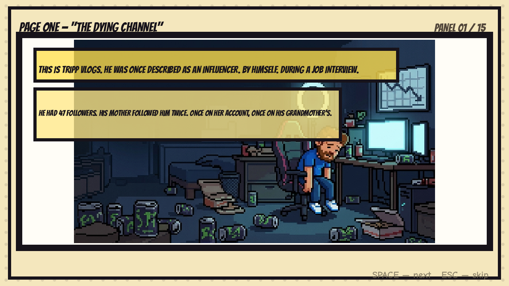
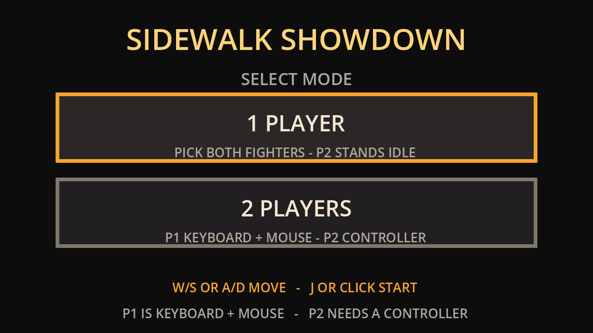
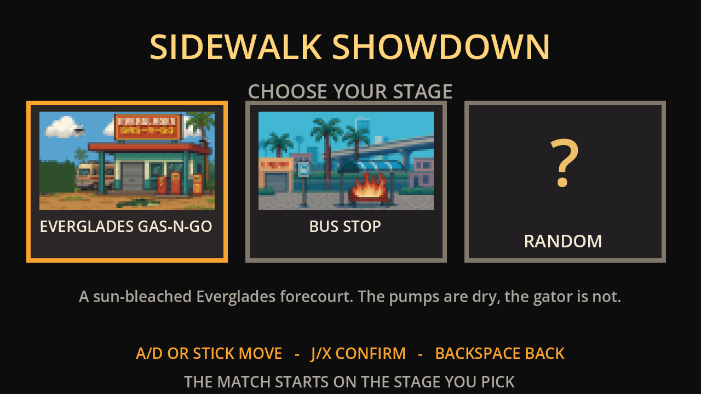
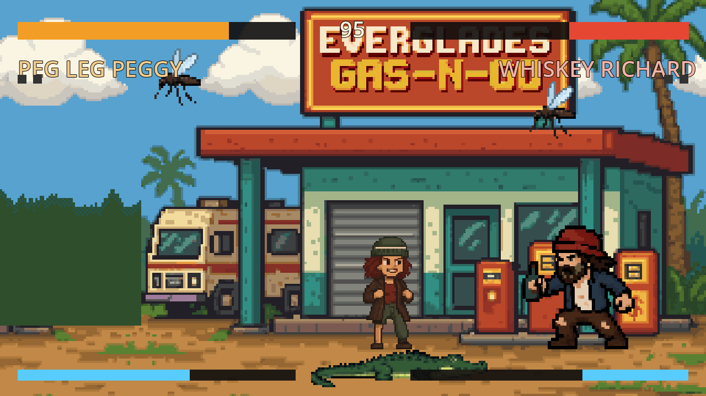

# Sidewalk Showdown

**A mature-rated 2D retro pixel-art arcade fighter about a washed-up livestreamer
who turns sidewalk chaos into a rigged tournament.**

[](https://github.com/violentwave/sidewalk-showdown/actions/workflows/tests.yml)
[](https://github.com/violentwave/sidewalk-showdown/actions/workflows/export.yml)

<p align="center">
  
</p>

| The Clip — intro | Select mode | Choose your fighter |
|---|---|---|
|  |  |  |

| Choose your stage | Gas-N-Go, mid-round | Bus Stop, mid-round |
|---|---|---|
|  |  |  |

| | |
|---|---|
| **Engine** | Godot 4.7 (`game/`) |
| **Target** | PC first — Windows / Linux / macOS |
| **Status** | GDD Phase 2 — vertical slice, in progress ([`docs/PHASE_STATUS.md`](docs/PHASE_STATUS.md)) |
| **License** | TBD — treat as all-rights-reserved until a LICENSE file lands ([`docs/LICENSE_OPTIONS.md`](docs/LICENSE_OPTIONS.md)) |

## What's playable today

- **The Clip** — a 15-panel comic intro that leads into mode select, with
  Space-only advancement and a complete skip path.
- **Solo and local versus** — pick `1 PLAYER`, choose the CPU difficulty
  (EASY / NORMAL / HARD), then pick both fighters and fight the CPU as P2, or
  `2 PLAYERS` for Peg Leg Peggy vs Whiskey Richard.
  After the fighters, a shared **stage select** offers Everglades Gas-N-Go, the
  Bus Stop, and a RANDOM card that resolves before the match. P1 uses
  keyboard + mouse; P2 uses a controller in versus. The CPU opponent is
  deterministic and plays by the exact same input rules as a human — see
  [`docs/CPU_OPPONENT.md`](docs/CPU_OPPONENT.md).
- **Two layered stages with ambience** — Gas-N-Go scrolls clouds, loops
  mosquitoes in the upper sky, and breathes/blinks a sunbathing gator; Bus Stop
  scrolls its own clouds, loops a four-frame shelter fire, and flickers the
  liquor sign. Ambient motion freezes with the pause menu and keeps running
  through hitstop ([`docs/STAGES.md`](docs/STAGES.md)).
- **Authored sprite animation** — both fighters play per-state and per-move
  clips from the owner's PixelLab batch: jumps, walks, guard, hit reactions,
  knockdown/wake-up, and all 16 attack rows per fighter
  ([`docs/PIXELORAMA_PIPELINE.md`](docs/PIXELORAMA_PIPELINE.md) §8–§9a).
- **Fighting-game systems** — 60 Hz deterministic simulation, frame data,
  blocking with chip that can't KO, hitstop, buffers, directional specials,
  EX spenders, throws and throw techs, juggle cap, a METHtality finisher, and
  side switching: fighters auto-face each other and can walk through each
  other on the ground and in the air (the `fighters_can_pass_through` flag
  restores the legacy grounded pushbox) —
  [`docs/SIDE_SWITCHING.md`](docs/SIDE_SWITCHING.md).
- **Match structure** — rounds, timer, sudden death after repeated timeouts,
  KO flow, pause menu, and a text-only Tripp commentary sample.

Not in yet: input remapping, campaign, stage rotation/tournament order,
final audio/voice/VFX, and final art/cleaning for some clips. The solo CPU
opponent is real (deterministic, three difficulties) but deliberately
simple — no fuzzy guard, no character-specific gameplans; it is a fair
sparring partner, not a tournament opponent. Online play is deferred beyond v0.1
per GDD §2.4/§16.

## Quick start

Requires **Godot 4.7.x** (the project reports `4.7.2`).

```bash
godot --path game                # play
godot --headless --path game --import   # first run: build the import cache

# test suites (all headless, all deterministic)
godot --headless --path game --script res://tests/combat_test.gd
godot --headless --path game --script res://tests/round_flow_test.gd
godot --headless --path game --script res://tests/character_select_test.gd
godot --headless --path game --script res://tests/locomotion_speed_test.gd
godot --headless --path game --script res://tests/stage_select_test.gd
godot --headless --path game --script res://tests/stage_floor_test.gd
godot --headless --path game --script res://tests/the_clip_test.gd
```

Current suites: **combat 407 checks**, round flow 34, character select 49,
locomotion speed 7, stage select 94, stage floor 9, The Clip 23 — all green in CI (`tests.yml`). `tests/air_probe.gd`
prints balance metrics and asserts nothing.

## Controls

**P1 plays on keyboard + mouse; P2 plays on a controller.** Any connected pad
drives P2, using either the d-pad or the left stick to move. The pad layout is
GDD §4.2's: X light, Y heavy, B special, A grab, right shoulder for the
METHtality finisher.

After The Clip, **mode select** opens on `1 PLAYER` (solo) with `2 PLAYERS` one
keypress away (W/S or A/D to move, J or click to start):

- **1 PLAYER:** choose the CPU difficulty (EASY / NORMAL / HARD, W/S or A/D,
  J confirms, Backspace goes back), then P1 picks their fighter, confirms, and
  picks the opponent with the same keys. P2 is played by the CPU at the chosen
  difficulty. Backspace steps back one pick, then back to mode select.
- **2 PLAYERS:** each player confirms their own fighter (P1 with J/click, P2 with
  pad X). Backspace on the P1 keyboard returns to mode select.

After both fighters are confirmed, **stage select** opens with Gas-N-Go, Bus
Stop (Night), and RANDOM last. W/S, A/D, the d-pad, or the stick move the shared
cursor; J/click or pad X confirms; Backspace returns to character select with
the same matchup. RANDOM resolves to a real stage before the match starts. The
match then loads the chosen stage and starts the round.

| Action | P1 keyboard / mouse | P2 controller |
|---|---|---|
| Move | A / D | D-pad or left stick |
| Jump | W | D-pad up or stick up |
| Crouch | S | D-pad down or stick down |
| Light attack | J or left click | X |
| Heavy attack | K or right click | Y |
| Special | L or middle click | B |
| Grab / throw | U | A |
| METHtality | I | Right shoulder (RB/R1) |
| Pause | Esc | Start / Menu |

- **Block** by holding away from the opponent (down-away blocks lows), including
  during blockstun. Chip damage cannot KO — a blocked hit always leaves 1 HP.
- **EX specials:** hold Heavy while pressing Special to spend 50 meter on the
  stronger version; without meter the base special comes out for free. The
  meter builds **only when you land hits** (throws included): blocked hits,
  whiffs, and taking damage award nothing.
- **METHtality:** with a full meter, press METHtality to spend the whole bar.
  Current presentation is a freeze plus banner; the normal KO flow ends the round.
- **Specials are directional:** neutral, forward, back, down, and air (GDD §4.4).
- `Enter` restarts after a match ends. Pause menu drives with W/S, the d-pad or
  stick, or arrows; J, X, or Enter picks. Options are **Resume**, **Restart
  Match**, **Back to Character Select**, and **Quit to Desktop**. Back to
  Character Select discards the in-progress match with no winner, keeps the
  current mode, and restores the matchup you were just playing.

Debug keys: **F1** boxes (on by default), **F2** frame state/advantage/invuln,
**F3** input history, **F4** slow motion, **F5** frame-step, **F6** refill both
fighters. The input map is generated, not hand-edited: change the tables in
`game/tools/setup_input.gd` and run
`godot --headless --path game --script res://tools/setup_input.gd`, then restore
the `[physics] 60 Hz` entry that `ProjectSettings.save()` drops (the tool says so).

## Builds

Pushing to `main` (or a `v*` tag) exports both desktop targets: a Linux x86_64
binary and a Windows x64 `.exe`, each with the PCK embedded as a single runnable
file. Grab them from the **Artifacts** section of an `export` run in the Actions
tab, named `sidewalk-showdown-linux-<sha>` / `sidewalk-showdown-windows-<sha>`
(kept 14 days).

Presets live in `game/export_presets.cfg` (`linux`, `windows`). Locally, with
Godot 4.7.2 export templates installed:

```bash
godot --headless --path game --import
godot --headless --path game --export-release linux build/linux/sidewalk_showdown.x86_64
godot --headless --path game --export-release windows build/windows/sidewalk_showdown.exe
```

> The repo is public, so Actions minutes and artifact storage are not billed.
> Both targets build and both artifacts upload successfully on every `main`
> push; the last verified run published a ~54 MB Linux binary and a ~64 MB
> Windows `.exe`. The workflow still downloads Godot's export templates per run
> instead of caching the ~1 GB bundle, which keeps each job independent of a
> stale cache at a cost of about a minute.

## Repository map

```text
game/                  Godot 4.x project
  scenes/              match, fighters, stages, menus, HUD
  scripts/             combat, match, ui, debug, stages, audio
  resources/           data resources: fighter stats/moves, stages, match roster
  tests/               headless suites + manual render/soak harnesses
  tools/               data generators, input setup, screenshot/README capture
  art/                 runtime art (idle sheets, authored clip libraries)
art/source/            raw owner-supplied batches (never cleaned in place)
  Characters/Animations/generated/full_animation_batch_01/
                       source sheets, prepared strips, per-clip manifests
art/tools/             reproducible prep scripts for the animation batches
art/exports/           cleaned, snake_case, runtime-ready static art
docs/                  supporting docs, audits, pipeline notes, screenshots
```

## Documentation

| Doc | What it covers |
|---|---|
| [`docs/PHASE_STATUS.md`](docs/PHASE_STATUS.md) | GDD phase requirements vs evidence, decisions, blockers |
| [`docs/KNOWN_ISSUES.md`](docs/KNOWN_ISSUES.md) | Prototype gaps, test inventory, known limitations |
| [`docs/PIXELORAMA_PIPELINE.md`](docs/PIXELORAMA_PIPELINE.md) | Idle-sheet + authored-clip pipeline for both fighters (§8–§9b) |
| [`docs/STAGES.md`](docs/STAGES.md) | Gas-N-Go layers/ambience, thumbnail regeneration, stage select, adding a stage |
| [`docs/PROPOSALS.md`](docs/PROPOSALS.md) | Combat system proposals and measured first passes |
| [`docs/ART_CREDITS.md`](docs/ART_CREDITS.md) | Art provenance, font licenses, all-rights-reserved notes |
| [`docs/MAIN_BRANCH_GUARD.md`](docs/MAIN_BRANCH_GUARD.md) | Why `main` only accepts squash-merged PRs |
| [`docs/audits/`](docs/audits) | Preserved historical audits and reconciliations |
| [`GAME_BIBLE.md`](GAME_BIBLE.md) | Story/world canon (Tripp, roster, stages, METHtalities) |
| [`GDD.md`](GDD.md) | Full design and production plan |
| [`CHARACTERS.md`](CHARACTERS.md) | Roster bible (archetypes, rivals, data direction) |

**Canon locks:** Tripp Vlogs is the only boss and is not playable. Roster = 15
fighters, one unique METHtality each. No real towns, brands, or public figures —
this is fictional "Sidewalk Florida".

## Architecture rules

- **Simulation is a fixed 60 Hz clock.** Frame data, hitstun, blockstun,
  hitstop, and buffer windows are all in simulation frames; presentation
  counters advance on the same clock so pause and hitstop freeze everything.
- **Fighters are data.** `game/resources/fighters/*.tres` define stats and
  moves; combat code never hard-codes per-fighter balance. Regenerate with
  `godot --headless --path game --script res://tools/gen_fighter_data.gd`.
- **Art is layered.** Source batches stay byte-for-byte untouched in
  `art/source/`; normalized strips and manifests are produced by
  `art/tools/prepare_*_batch.py`; runtime copies live in
  `game/art/characters/*/clips/`. Idle sheets remain the approved fallback for
  any gated or missing clip.
- **Presentation never changes gameplay.** Clip tables control which cel and
  cadence are shown; damage, timings, hitboxes, knockback, movement, collision,
  buffers, cancels, invulnerability, hitstop, and round rules stay in the sim.

## Contributing

`main` is squash-merge-only. Branch from `origin/main`, open a PR, wait for
`tests` to pass, then squash-merge
([`docs/MAIN_BRANCH_GUARD.md`](docs/MAIN_BRANCH_GUARD.md)). Keep gameplay data
changes separate from presentation-only changes, and run the five test suites
before pushing.
